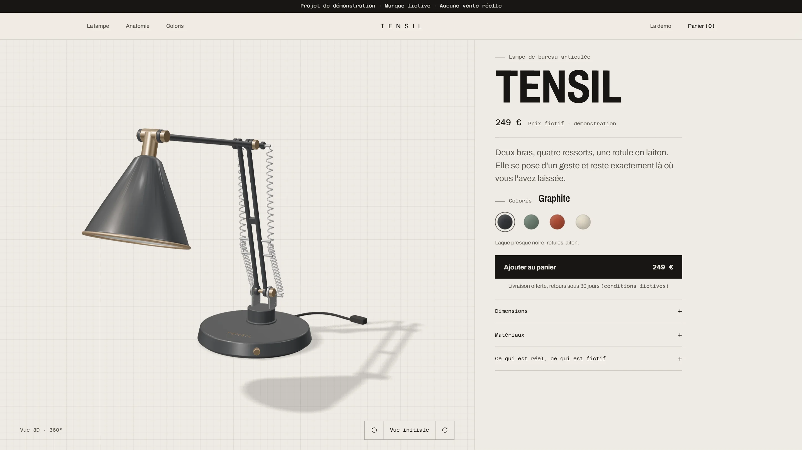

# TENSIL — boutique de démonstration

> **Projet de démonstration.** TENSIL est une marque fictive : aucun produit n'est vendu, aucun paiement n'est demandé, aucune donnée saisie ne quitte le navigateur.
>
> **Démo en ligne : https://tensil-store.vercel.app** (Vercel, offre Hobby gratuite).



## 1. Objectif
Boutique e-commerce mono-produit pour la lampe articulée TENSIL, modélisée dans le projet [blender-studio-object](https://github.com/elie-gordo/blender-studio-object). Le site montre un parcours d'achat complet (coloris → panier → commande simulée → confirmation) autour d'une **vue 3D à 360° en quatre coloris**, dans une direction artistique sobre inspirée des éditeurs de luminaires haut de gamme.

## 2. Public et besoin
- **Public réel** : recruteurs (front-end, intégration 3D web) et clients PME qui envisagent un site e-commerce.
- **Public fictif** : acheteur d'un objet design qui veut le voir sous tous les angles avant d'acheter. Un objet de ce prix s'achète mal sur une simple photo : la 3D manipulable et le changement de coloris en direct répondent à ce besoin.

## 3. Pages et fonctionnalités
| Page | Contenu |
|---|---|
| `/` Produit | Photo studio du coloris choisi, vue 3D 360° chargée à la demande (souris, toucher, clavier), 4 coloris (URL partageable `?coloris=sauge`), ajout au panier, caractéristiques, anatomie (gros plan), film de 8 s, galerie des coloris, FAQ, barre d'achat fixe sur mobile |
| Tiroir panier | Quantités (1 à 5 par coloris), suppression, sous-total, état vide, message si le stockage est bloqué |
| `/panier` | Même panier en pleine page, récapitulatif |
| `/commande` | Formulaire de livraison simulé : validation champ par champ, résumé d'erreurs avec liens, envoi simulé, aucun champ bancaire |
| `/confirmation` | Numéro de commande fictif, récapitulatif ; message clair si aucune commande |
| `/a-propos` | Réel / fictif, rôle de l'IA, crédits et licences |
| `/404` | Page d'erreur |

**États gérés** : 3D non chargée / chargement (barre de progression) / chargée / échec ou WebGL absent (photo conservée) / économiseur de données (3D seulement sur demande) ; panier vide ; formulaire invalide ; envoi en cours ; confirmation sans commande ; `prefers-reduced-motion` (pas de rotation automatique ni d'animation).

## 4. Technologies et dépendances
| Élément | Version | Rôle | Licence |
|---|---|---|---|
| [Astro](https://astro.build) | 7.4.0 | Site statique, optimisation des images | MIT |
| TypeScript | 5.9.3 | Typage, `astro check` | Apache-2.0 |
| [three.js](https://threejs.org) | 0.186.1 | Vue 3D (GLTFLoader, MeshoptDecoder, OrbitControls, RoomEnvironment) | MIT |
| Inter (variable), Instrument Serif | @fontsource 5.3.0 | Polices auto-hébergées | SIL OFL 1.1 |
| Vitest | 5.0.5 | Tests unitaires | MIT |
| Playwright + @axe-core/playwright | 1.64.1 / 4.14.0 | Tests de bout en bout et d'accessibilité, captures | Apache-2.0 / MPL-2.0 |
| sharp | 0.35.5 | Conversion des captures en WebP (déjà utilisé par Astro) | Apache-2.0 |
| Blender | 5.2.2 LTS | Export GLB et rendus des coloris (scripts dans `tools/blender/`) | GPL (créations libres) |
| glTF-Transform CLI | 4.5.1 | Compression Meshopt du GLB | MIT |

Aucun backend, aucune base de données, aucun service tiers, aucun cookie, aucune mesure d'audience.

## 5. Installation et lancement
Prérequis : Node.js ≥ 22.22.

```bash
npm install
npm run dev          # http://localhost:4321
npm run build        # astro check + build statique dans dist/
npm run preview      # sert dist/
npm test             # tests unitaires
npx playwright install chromium   # une fois
npm run test:e2e     # E2E + axe (lancer `npm run preview` avant)
BASE_URL=https://tensil-store.vercel.app npm run test:e2e   # mêmes tests sur le site en ligne
npm run screenshots  # captures du portfolio dans docs/screenshots/ (`npm run preview` avant)
```

Les captures sont cadrées sur les limites réelles des sections (et non au défilement), en `prefers-reduced-motion` pour un rendu identique à chaque exécution : desktop 1440 px ×2, mobile iPhone 13 ×3.

### Régénérer les assets 3D (optionnel)
Nécessite Blender 5.2 et le dépôt `blender-studio-object` cloné à côté de celui-ci. Les scripts du dépôt lampe sont réutilisés **sans modification**.

```bash
B="C:/Program Files/Blender Foundation/Blender 5.2/blender.exe"
# GLB boutique + src/data/colorways.json
"$B" -b --factory-startup --python tools/blender/export_store.py -- \
  --lamp-scripts ../blender-studio-object/blender/scripts \
  --out tools/blender/out/tensil_store_raw.glb --colorways src/data/colorways.json
npx @gltf-transform/cli@4.5.1 optimize tools/blender/out/tensil_store_raw.glb public/models/tensil.glb \
  --compress meshopt --palette false --join false --flatten false
# 8 rendus des coloris (3/4 et profil, fond transparent, ~6 min sur RTX 2050)
"$B" -b --factory-startup --python tools/blender/render_store.py -- \
  --lamp-scripts ../blender-studio-object/blender/scripts --out src/assets/lamp --samples 128
# gros plan de la section Anatomie (graphite uniquement)
"$B" -b --factory-startup --python tools/blender/render_store.py -- \
  --lamp-scripts ../blender-studio-object/blender/scripts --out src/assets/lamp --samples 128 \
  --colorway graphite --shot detail
```

## 6. Choix de conception
- **Un seul GLB, quatre coloris.** Le GLB d'origine avait ses matériaux fusionnés en textures « palette » par `gltf-transform optimize` : impossible de recolorer la laque seule. L'export boutique garde `MAT_Lacquer` séparé ; la page change sa teinte en direct (fondu de 450 ms). Les valeurs viennent de `materials.py` via `src/data/colorways.json` : une seule source pour les rendus Blender, la 3D et les pastilles CSS (conversion linéaire → sRGB testée).
- **Modèle nettoyé pour le 360°.** Câble de 80 cm raccourci et terminé par une prise (emprise au sol 1,27 m → 0,69 m, la rotation reste centrée), rugosité du métal brossé rétablie (le bruit procédural ne s'exporte pas en glTF), ampoule opaque (pas de passe de transmission). Résultat : 199 Ko, `gltf-transform validate` sans erreur ni avertissement.
- **3D à la demande.** La photo studio est l'élément LCP ; three.js (~212 Ko gzip au total) et le GLB ne se chargent qu'au premier signe d'intention (souris, toucher, clavier, focus) ou via le bouton « Tourner en 3D ». Une première version qui chargeait la 3D automatiquement obtenait 58 en performance Lighthouse mobile (TBT 5,6 s) ; la version à la demande obtient 99.
- **Cadrage adaptatif.** La distance caméra est calculée sur le champ de vision le plus étroit : la lampe n'est jamais coupée en portrait.
- **Rendus à fond transparent.** Le fond studio devient un *shadow catcher* : chaque photo garde son ombre de contact et se pose sur le fond de la page, quel qu'il soit. L'alpha est ensuite fondu sur les 8 % du bord du cadre, pour que la grande ombre douce ne s'arrête jamais sur une arête nette. Le gros plan de l'anatomie est rendu directement en 4:5 pour remplir sa colonne sans agrandissement.
- **Direction artistique « galerie ».** Références observées : Flos, Astep, Michael Anastassiades, Apparatus (filets fins, capitales espacées, grands vides, objet seul). Papier chaud `#efebe4`, encre `#171614`, laiton réservé aux interactions (survol des boutons, focus clavier), une seule section sombre pour la lumière. Instrument Serif pour les titres, Inter (la police du logo TENSIL) pour l'interface.
- **Accessibilité.** Coloris en boutons radio natifs, tiroir en `<dialog>` modal (focus piégé, Échap), vue 3D focusable pilotable aux flèches, +/−, Début ; erreurs de formulaire reliées par `aria-describedby` et résumé focalisé ; lien d'évitement ; contrastes vérifiés par axe.
- **Données.** Le panier est validé à la lecture (`parseCart` ignore toute donnée inconnue ou hors bornes) : le stockage local est traité comme une entrée non fiable.

## 7. Licences et ressources tierces
Voir [docs/CREDITS.md](docs/CREDITS.md). Aucune image, texture ou police tierce hors celles listées ; les visuels sont des images de synthèse produites par le projet.

## 8. Vérifications effectuées
| Vérification | Résultat | Conditions |
|---|---|---|
| `astro check` | 0 erreur, 0 avertissement | |
| Tests unitaires (Vitest) | 14/14 | panier, commande, couleurs |
| E2E Playwright | 26/26, deux exécutions consécutives | 13 scénarios × Chrome desktop 1440 px et Pixel 7 |
| axe (WCAG 2.1 A/AA) | 0 violation détectée | `/`, `/panier`, `/commande`, `/a-propos`, `/404` |
| Débordement horizontal | Aucun | 4 pages, desktop et mobile |
| Lighthouse mobile, page produit | Performance 99, Accessibilité 100, Bonnes pratiques 100, SEO 100 | Lighthouse 12, aperçu local, throttling simulé ; LCP 1,9 s, TBT 0 ms, CLS 0,006, 161 Kio transférés |
| GLB | `gltf-transform validate` : 0 erreur | rendu de contrôle des 4 angles dans Blender |
| Contrôle visuel | desktop 1440 px et mobile 390 px | Chrome |
| Production (Vercel) | 7 routes OK (dont 404), en-têtes de sécurité présents, vue 3D fonctionnelle sous CSP stricte sans erreur console | 2026-10-16 |
| E2E + axe sur la production | 26/26 ; axe 30/30 sur 3 répétitions | `BASE_URL=https://tensil-store.vercel.app` |

**Non vérifié** : Firefox et Safari, appareils physiques, lecteur d'écran (test manuel), Lighthouse sur les pages autres que `/` et sur l'URL de production.

## 9. Limites connues
- Prix, livraison, retours et commandes **fictifs**.
- La teinte de la 3D temps réel diffère légèrement des rendus Cycles (moteurs et éclairages différents).
- L'ampoule n'est pas allumée dans la vue 3D (l'intensité d'émission n'est pas animée en glTF).
- La 3D charge environ 212 Ko de JavaScript gzip + 195 Kio de GLB : raisonnable sur ordinateur, plus lourd sur mobile d'entrée de gamme (d'où le chargement à la demande).
- La CSP autorise `'unsafe-inline'` pour les styles (attributs `style` des pastilles de coloris) ; les scripts restent limités à `'self'` (+ `'wasm-unsafe-eval'` pour le décodeur Meshopt).
- L'offre Hobby de Vercel est réservée à un usage personnel non commercial : le site doit rester une démo sans vente.
- Le film MP4 (2,6 Mo) n'est chargé que sur clic.

## 10. Coûts
**0 € engagé.** Logiciels libres, rendus sur le PC personnel. Aucun frais futur nécessaire. Détail : [docs/COSTS.md](docs/COSTS.md).

## Publication
- **Hébergeur** : Vercel, projet `tensil-store`, offre Hobby (gratuite, [usage personnel non commercial](https://vercel.com/docs/limits/fair-use-guidelines#commercial-usage), 100 Go de transfert/mois inclus). Déployé le 2026-10-16.
- **Déploiement continu** : le dépôt GitHub est relié ; chaque push sur `main` redéploie la production.
- **Configuration** : `vercel.json` (build `npm run build`, sortie `dist`, URL sans `.html`, CSP et en-têtes de sécurité, cache long sur `/_astro/*`) ; variable d'environnement `SITE_URL=https://tensil-store.vercel.app` (URL canonique et image Open Graph absolues).
- **Domaine** : sous-domaine Vercel uniquement ; `elie-gordo.fr` non utilisé.

## Documentation
- [Brief validé](docs/BRIEF.md)
- [Étude de cas](docs/CASE_STUDY.md)
- [Éléments pour le portfolio](docs/PORTFOLIO.md)
- [Crédits et licences](docs/CREDITS.md)
- [Coûts](docs/COSTS.md)
